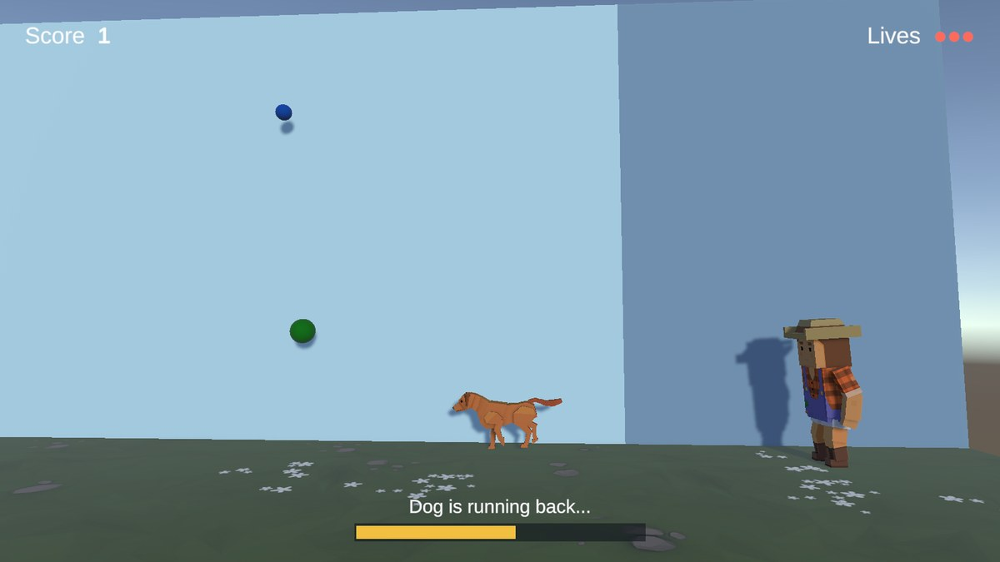
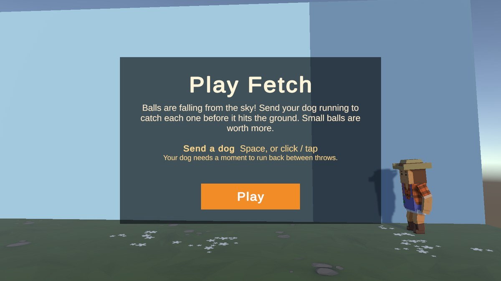

# Play Fetch

A small Unity game. Balls fall from the sky and you send your dog running to catch them before they hit the ground. It's built on **Challenge 2: Play Fetch** of Unity Learn's [Junior Programmer pathway](https://learn.unity.com/pathways), with the course's bonus features added.

**▶ Play it in your browser:** https://mahesh21723.github.io/dog-catch-ball/

  



## How to play

| | Keyboard | Mouse / touch |
|---|---|---|
| Send a dog | Space | Click / tap the field |
| Start / restart | Enter or Space | Play button |

- Balls drop from random spots at random intervals. Send a dog at the right moment so it runs under the ball and catches it.
- **Small balls are worth 3 points, medium 2 and big 1.**
- Your dog needs about a second to come back, so you can't spam it. The bar at the bottom shows when the next dog is ready.
- If a ball hits the ground you lose a life. With **3 lives** gone, it's game over. Balls come a bit faster and more often the longer you last, and your best score is saved.



## What I added to the course challenge

- Fixed the challenge's bugs: balls now spawn at random intervals and positions, the dogs run along the ground and catch balls, a caught ball is destroyed together with the dog, and a missed ball is detected at the ground
- Title screen, score, lives, game over, best score and play again (UI built from code in `GameManager`)
- Dog cooldown with a visible "dog ready" bar, plus mouse / touch controls
- Ball values (small ball = more points), and a difficulty ramp (`SpawnManager`)
- Cleaned-up script names (the course's `...X` suffix is gone) and a hosted WebGL build

## Scripts

| Script | What it does |
|---|---|
| [`PlayerController`](Assets/Challenge%202/Scripts/PlayerController.cs) | Sends a dog on Space / click, with a cooldown |
| [`SpawnManager`](Assets/Challenge%202/Scripts/SpawnManager.cs) | Drops random balls at random times and places, faster over time |
| [`MoveForward`](Assets/Challenge%202/Scripts/MoveForward.cs) | Moves dogs along the ground and makes balls fall |
| [`DetectCollisions`](Assets/Challenge%202/Scripts/DetectCollisions.cs) | When a dog touches a ball, the ball is caught and you score |
| [`DestroyOutOfBounds`](Assets/Challenge%202/Scripts/DestroyOutOfBounds.cs) | Removes dogs that run off the left edge; a ball that reaches the ground costs a life |
| [`Ball`](Assets/Challenge%202/Scripts/Ball.cs) | Marks a ball and holds its point value |
| [`GameManager`](Assets/Challenge%202/Scripts/GameManager.cs) | Game states, score, lives, best score and the interface |
| [`UIKit`](Assets/Challenge%202/Scripts/UIKit.cs) | Small helpers that build the interface from code |

The course's *Prototype 2: Feed the Animals* lives in its own repo: [feed_animal](https://github.com/MAHESH21723/feed_animal).

## Run it yourself

1. Open the project in **Unity 6 (6000.6)** with the WebGL module installed.
2. Open `Assets/Challenge 2/Challenge 2.unity` and press **Play**.
3. To rebuild the browser version, use **Play Fetch → Build WebGL to docs**, or run it headless:
   ```
   Unity.exe -batchmode -quit -projectPath . -buildTarget WebGL -executeMethod WebBuild.Build
   ```
   The build goes to `docs/`, which GitHub Pages serves.

## Credits

- **Course and project base:** [Unity Learn – Junior Programmer pathway](https://learn.unity.com/pathways), *Challenge 2: Play Fetch*, by Unity Technologies.
- **3D models (dog, balls, farmers, environment):** from the Unity Learn *Course Library*, provided to Unity Learn by [Synty Studios](https://assetstore.unity.com/publishers/5217). As the included [licence note](Assets/Course%20Library/_Source_Files/_LICENSE.txt) says, these assets are **not for commercial use**. This project is a non-commercial learning project.
- **Font:** Liberation Sans (SIL Open Font License), bundled with TextMesh Pro.
- **Game code and additions:** Maheshwaran.

## Author

**Maheshwaran**: [kmaheshwaran9965@gmail.com](mailto:kmaheshwaran9965@gmail.com) · [github.com/MAHESH21723](https://github.com/MAHESH21723)
